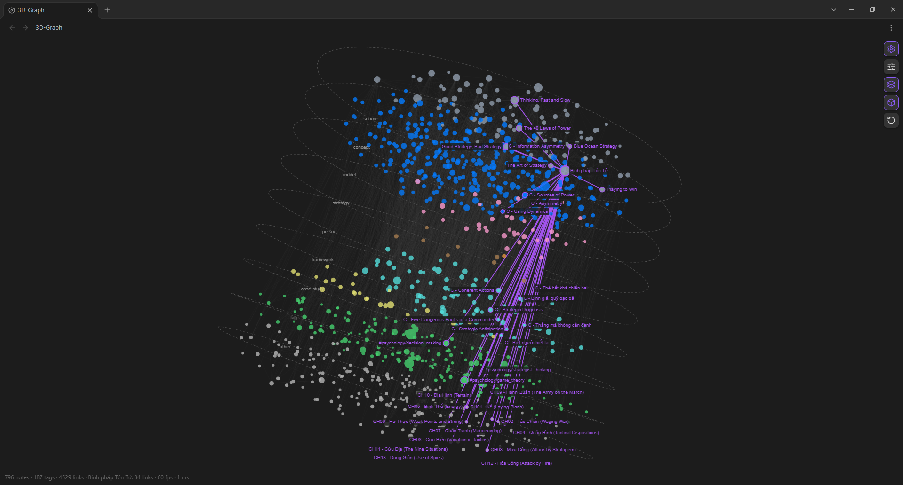
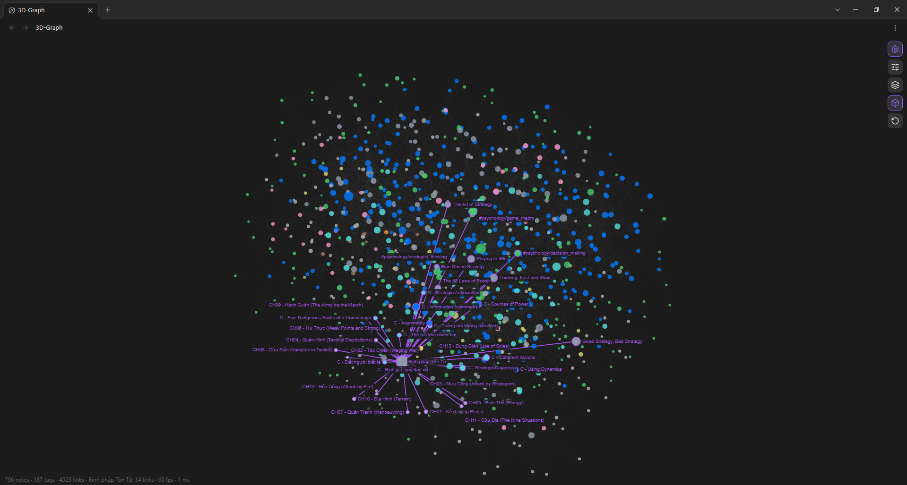

<div align="center">

# 3D-Graph

> *"A layered vault should not be drawn as a hairball."*



[](LICENSE)
[](https://obsidian.md)
[](#install)
[](#how-it-works)

<br>

**3D-Graph is a 3D graph view for Obsidian that sorts a large vault into layers.**

<sub>A personal plugin. It keeps the core Graph view's look, search and color groups, and adds a 3D camera and a Layers view. Plain JavaScript, no build step, no runtime dependencies.</sub>

<br>

[Tiếng Việt](README.vi.md)

<br>

</div>

---

## Example

```
You       ❯ Open "Binh pháp Tôn Tử" in the main window.

3D-Graph  ❯ The note gets a purple ring on the source floor.
            Its 34 links turn purple and climb through the other floors,
            to concepts, frameworks, chapters and tags.

            Every linked note is labeled, so you can read what it feeds
            without opening any of them.
```

```
You       ❯ The graph is too crowded. Show me only what is around this note.

3D-Graph  ❯ Settings > Filters > Local depth: 2 hops. The rest of the vault
            disappears and the graph is fitted to the canvas again.
```

These are illustrative examples. The numbers come from the author's vault in the screenshots (796 notes, 187 tags, 4,529 links).

---

## The problem: graph views stop helping at around 1,000 notes

The author's vault is a knowledge graph with an explicit structure: `Concept → Model → Strategy → Execution`, plus Sources, People, Frameworks and Case Studies. At about 800 notes it already had 4,500 links, and it keeps growing past 1,000. At that size graph views stop answering the one question a structured vault needs answered: **how do my notes connect across layers?**

1. **The core Graph view is too basic.** It is a flat 2D force layout. Thousands of nodes and links collapse into a hairball. Color groups and filters help you find a note, not see the structure: every note is the same kind of dot, there is no depth, and a source note sits in the same cloud as the concept it feeds.
2. **Other graph views are too flashy.** Glow, neon, particles and animated "galaxy" palettes look striking in a demo, but they replace the colors you chose with decoration, and they cost frame rate and attention when you are trying to work. Color and position stop carrying information.
3. **None of them separates notes by layer.** As far as the author could find, no graph view stacks notes by their type. A layered vault is naturally a tower, yet every graph draws it as one cloud, so you cannot see how links climb from sources through concepts and models to strategies.

3D-Graph exists to fix exactly this: stay as calm and as faithful to the core Graph view as possible, and add only what a large, layered vault needs.

### How 3D-Graph handles it

| Problem at 1,000+ notes | What 3D-Graph does |
|---|---|
| A flat hairball with no room for structure | A **3D camera**: the vault becomes one compact object you can turn. It spins slowly like a globe (clockwise, tilted axis) and pauses while your pointer is over it. |
| You cannot see the structure | **Layers view** stacks notes as floors of a tower by their `layer` or `type` frontmatter. |
| Too basic, or too decorative | The **same look as the core Graph view**: color groups (with their alpha) are read from `.obsidian/graph.json`, other notes use `--graph-node`, links use `--graph-line`, tags are green. No glow, no effects. |
| Hard to see where one note sits | The note open in any window gets a purple ring. Its linked notes and the links between them turn purple too, and every linked note is **labeled** (labels are moved so they do not overlap). |
| Too many nodes at once | Core-style **search** (`path:`, `file:`, `tag:#x`, `["layer":concept]`, `-`, `OR`), a **local graph** of 1-3 hops, and toggles for tags and orphans. |
| A big graph never fits the screen | **Auto-scale**: the graph is fitted to the canvas (97% of the half-canvas by default, adjustable), measured over a full turn so it never clips while spinning, and re-fitted whenever you switch 3D, Layers view or 2D. |

### Two views of the same vault



*Without layers: one compact object. "Binh pháp Tôn Tử" is open in the main window, so it and every note linked to it are purple and labeled. The rest of the vault is drawn in your own color groups.*

The first screenshot is the same graph with **Layers view** on. Each kind of note gets its own floor (the dashed discs), from `source` at the top to `other` at the bottom. Links from the open note climb through the floors, so you can read the structure at a glance: which concepts a source feeds, which models formalize them, and which strategies use those models. Floors are about 30% wider and the gap between them about 10% smaller than the base layout, so the tower stays compact. Both are adjustable.

---

## Install

1. Download `main.js`, `manifest.json` and `styles.css` from the [latest release](https://github.com/minhtranc1991/3d-graph-obsidian/releases/latest).
2. Put them in `<your vault>/.obsidian/plugins/3d-graph/`.
3. Reload Obsidian and enable **3D-Graph** under Settings, Community plugins.
4. Open it from the ribbon icon (orbit) or the command **Open 3D-Graph**.

Requires Obsidian 1.4.0 or newer, desktop only.

### Usage

A single gear icon sits in the top-right corner. Click it to reveal four buttons:

| Button | What it does |
|---|---|
| Settings | Opens the settings menu (top right, every group collapsed). |
| Layers view | Turns the tower on or off. |
| 3D view | Switches between 3D and a flat 2D view. |
| Reset | Resets the camera and fits the graph again. |

Drag on empty space to rotate, `Shift`+drag or right-drag to pan, use the wheel to zoom, and click a note to open it (`Ctrl`/`Cmd`+click for a new tab). Clicking a tag filters the graph by that tag.

---

## What 3D-Graph shows

A note's floor is its `layer` property if it has one, otherwise its `type` property.

| Floor | Notes that land here | Decided by |
|---|---|---|
| source | Books, papers, courses | `type: source` |
| concept | Concepts | `layer: concept` |
| model | Models | `layer: model` |
| strategy | Strategies | `layer: strategy` |
| execution | Execution notes | `layer: execution` |
| person | People | `type: person` |
| framework | Frameworks | `type: framework` |
| case-study | Case studies | `type: case-study` |
| news | News items | `type: news` |
| tag | Tags, as green nodes linked to their notes | generated from your tags |
| other | Everything else, such as chapter or map notes | no `layer` or `type` |

Only floors that have notes appear. Colors come from your core Graph view color groups, so a concept looks the same here as it does there.

### Honest limits

- The canvas and the Obsidian API are only stubbed in the tests, so the plugin has not been verified against every theme.
- Search matches names, paths, tags and frontmatter, not note content.
- Single nodes cannot be dragged.
- The comparison with other graph views reflects the author's own search and experience, not a complete survey.

---

## Demo vault

`demo-vault/` is a small vault cloned from the author's vault: **one note per layer**. The tag floor is made of the tags those notes carry.

| Floor | Demo note |
|---|---|
| source | `Binh pháp Tôn Tử` |
| concept | `C - Information Asymmetry` |
| model | `M - Game Theory Model` |
| strategy | `S - Premortem` |
| person | `P - Charles Ponzi` |
| framework | `C - Thế bất khả chiến bại` |
| case-study | `CS - Cambridge Analytica` |
| other | `CH01 - Kế (Laying Plans)` |
| tag | 15 tags from the notes above |

The notes are trimmed copies and their links were rewired to point at each other. The text is Vietnamese, as in the original vault. To open it:

1. In Obsidian choose **Open folder as vault** and pick `demo-vault`.
2. Copy `main.js`, `manifest.json` and `styles.css` into `demo-vault/.obsidian/plugins/3d-graph/`.
3. Enable **3D-Graph**, open it from the ribbon icon, then open any note in the main window.
4. Press the layers button to see the nine floors.

`demo-vault/.obsidian/graph.json` carries the author's color groups, so the demo looks like the screenshots.

---

## Settings

| Group | Options |
|---|---|
| Filters | Search, local depth, Tags, Orphans |
| Groups | The color groups read from `graph.json`, Reload colors |
| Display | Node size and opacity, fade with depth, dim unrelated notes, link thickness and opacity, active-note link width, label size, auto-fit fill |
| Spin | On/off, clockwise, speed, axis tilt |
| Forces | Center, repel and link force, link distance |
| Layers | Width inside a layer, distance between layers |

---

## How it works

1. Read every note, its frontmatter, tags and resolved links from Obsidian's metadata cache.
2. Filter with a core-style query, keep notes within N hops of the active note in local mode, and add tag nodes.
3. Lay the nodes out with a grid-limited 3D force simulation. In Layers view every note is pulled to the floor of its layer, and links only act inside a floor so cross-layer links do not drag notes off it.
4. Project with a software camera (spin, axis tilt, your drag) and draw everything in one canvas pass: nodes batched by color and depth, edges as one path, a cached 3x3 matrix. If drawing is slow while spinning, a fixed subset of edges is drawn, and `fps` and draw time show in the bottom-left status line.
5. Fit the zoom to the canvas by measuring the largest screen offset over a full turn.

Metadata events only rebuild the layout when the visible notes, links or layers really change.

## Repository structure

```
3d-graph-obsidian/
├── main.js           # the plugin (plain JavaScript, no build step)
├── manifest.json
├── styles.css
├── versions.json
├── demo-vault/       # one note per layer + the author's graph.json
├── docs/images/      # screenshots used in the READMEs
├── test/smoke.cjs    # jsdom smoke tests
├── README.md
├── README.vi.md
└── LICENSE
```

## Contributing and development

- Report issues or suggest improvements through GitHub Issues.
- Run the tests with `npm install` then `npm test`. `test/smoke.cjs` loads `main.js` against a stubbed Obsidian API and a jsdom DOM (no Obsidian needed) and checks the query parser, the layout, rotation and input, the active-note highlight, tags, colors, the settings menu, 2D mode and the auto-fit bounds.

## License

MIT. See [LICENSE](LICENSE).

---

<div align="center">

**3D-Graph** shows how a layered vault connects, floor by floor.

</div>
