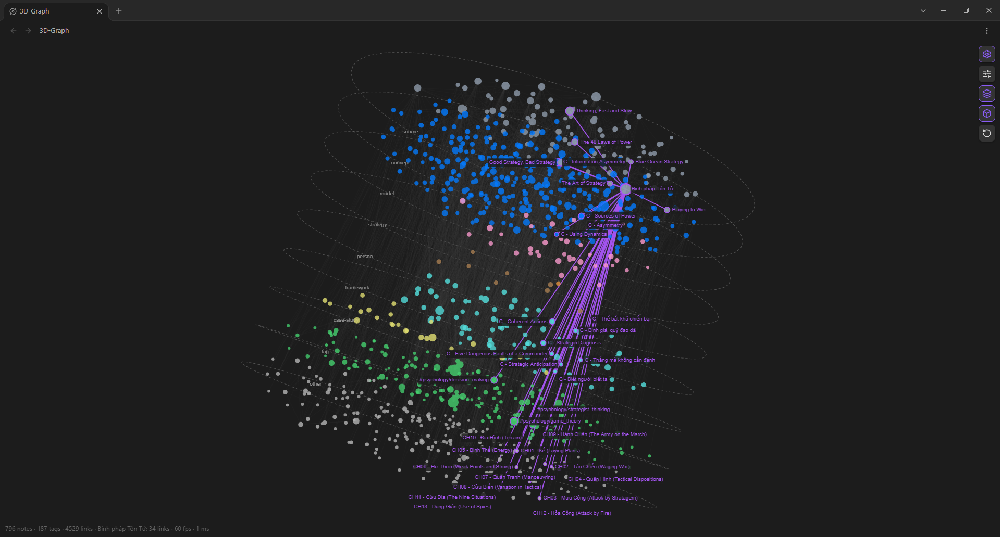
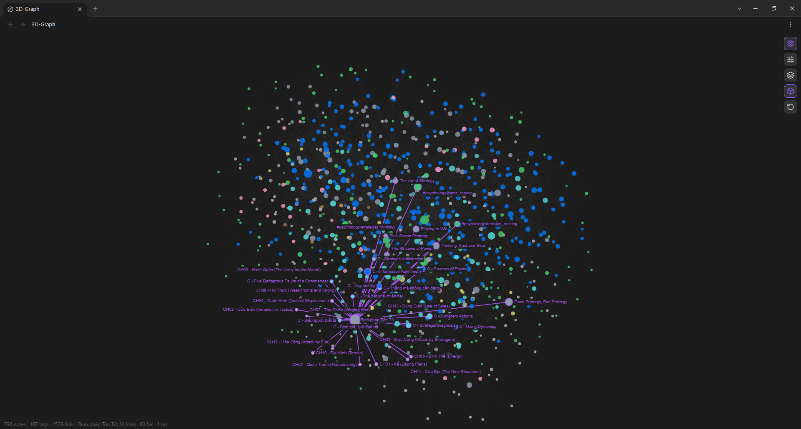

# 3D-Graph

**Graph view 3D cho Obsidian, xếp một vault lớn thành các tầng.**

[English](README.md) | Tiếng Việt



*796 note, 187 tag và 4.529 link, vẽ thành một tòa tháp. Mỗi tầng là một loại note. Các note và link màu tím thuộc về note đang mở ở cửa sổ chính.*

3D-Graph là plugin [Obsidian](https://obsidian.md) cá nhân. Nó giữ ý tưởng của **Graph view** gốc (note là node, link là cạnh, color group và bộ lọc lấy từ chính `graph.json` của bạn) và thêm hai thứ graph gốc không có: camera 3D tự dựng và **Layers view** xếp note theo loại. Không cần build, không phụ thuộc thư viện nào: `main.js` là JavaScript thuần.

## Vấn đề: graph view hết giúp được khi vault vượt khoảng 1.000 note

Các ảnh chụp lấy từ vault của tác giả. Đó là một knowledge graph có cấu trúc rõ ràng: `Concept → Model → Strategy → Execution`, cộng với Source, People, Framework và Case Study. Ở mức khoảng 800 note, vault đã có 4.500 link và 187 tag, và vẫn đang tăng vượt 1.000. Đến đây graph view không còn trả lời được câu hỏi duy nhất mà một vault có cấu trúc cần: **các note nối với nhau như thế nào giữa các tầng?**

1. **Graph view gốc quá cơ bản ở quy mô này.** Nó là layout lực 2D phẳng. Hàng nghìn node và link co lại thành một cục rối. Color group và bộ lọc giúp bạn tìm một note, nhưng không giúp thấy cấu trúc: mọi note đều là cùng một loại chấm, không có chiều sâu, và một note source nằm chung một đám mây với concept mà nó cung cấp.
2. **Các graph view khác đi theo hướng ngược lại: quá màu mè.** Ánh sáng, neon, hạt, bảng màu "thiên hà" chuyển động trông bắt mắt trong video demo, nhưng chúng thay màu bạn đã chọn bằng đồ trang trí, và tốn khung hình lẫn sự chú ý đúng lúc bạn đang làm việc. Màu sắc và vị trí không còn mang thông tin nữa.
3. **Chưa có graph nào tách note theo tầng.** Theo những gì tác giả tìm được, không graph view nào xếp note chồng lên nhau theo loại. Một vault có phân tầng vốn là một tòa tháp, nhưng mọi graph đều vẽ nó thành một đám mây, nên bạn không thấy được link đi từ source lên concept, model rồi tới strategy ra sao.

Vì vậy tác giả viết 3D-Graph để xử lý đúng vấn đề này: giữ nguyên sự điềm tĩnh và trung thành với Graph view gốc, chỉ thêm những gì một vault lớn, có phân tầng cần.

## 3D-Graph xử lý như thế nào

| Vấn đề khi vault trên 1.000 note | 3D-Graph làm gì |
|---|---|
| Cục rối phẳng, không có chỗ cho cấu trúc | **Camera 3D**: vault thành một vật thể gọn mà bạn xoay được. Nó tự quay chậm như địa cầu (cùng chiều kim đồng hồ, trục nghiêng) và dừng khi con trỏ nằm trên graph. |
| Không thấy được cấu trúc | **Layers view** xếp note thành các tầng của một tòa tháp theo thuộc tính `layer` hoặc `type` trong frontmatter: source, concept, model, strategy, person, framework, case-study, tag, other. |
| Quá cơ bản, hoặc quá trang trí | **Giao diện giống Graph view gốc**: color group (kèm độ trong suốt) đọc từ `.obsidian/graph.json`, note không thuộc nhóm nào dùng `--graph-node`, link dùng `--graph-line`, tag màu xanh lá. Không ánh sáng, không hiệu ứng. |
| Khó thấy một note nằm ở đâu | Note đang mở ở bất kỳ cửa sổ nào có vòng tím. Các note liên kết với nó và link giữa chúng cũng chuyển tím, và mọi note liên kết đều có **nhãn tên** (nhãn được dời để không đè nhau). |
| Quá nhiều node cùng lúc | **Tìm kiếm** kiểu graph gốc (`path:`, `file:`, `tag:#x`, `["layer":concept]`, `-`, `OR`), **local graph** 1–3 bước, và công tắc cho tag và note mồ côi. |
| Graph lớn không bao giờ vừa màn hình | **Tự co giãn (auto-scale)**: graph được fit vào canvas (mặc định 97% nửa khung, chỉnh được), đo qua cả một vòng quay nên không bị cắt khi đang quay, và fit lại mỗi khi bạn chuyển 3D, Layers view hoặc 2D. |

### Cả vault như một vật thể



*Cùng 796 note đó nhưng không chia tầng. Note "Binh pháp Tôn Tử" đang mở ở cửa sổ chính: nó và mọi note liên kết với nó màu tím và có nhãn, phần còn lại của vault dùng đúng color group của bạn.*

### Vault như một tòa tháp

Layers view là cùng graph đó, nhưng mỗi loại note có một tầng riêng (các đĩa nét đứt). Ở ảnh đầu, các tầng đi từ `source` ở trên cùng đến `other` ở dưới cùng. Link từ note đang mở đi xuyên qua các tầng, nên bạn đọc được cấu trúc trong một cái nhìn: source nào cung cấp cho concept nào, model nào hình thức hóa chúng, và strategy nào dùng các model đó. Mỗi tầng rộng hơn khoảng 30% và khoảng cách giữa các tầng nhỏ hơn khoảng 10% so với layout cơ sở để tòa tháp gọn; cả hai đều chỉnh được.

## Dùng thử: demo vault

`demo-vault/` là một vault nhỏ sao chép từ vault của tác giả: **mỗi tầng một note**. Tầng tag gồm các tag mà những note đó mang.

| Tầng | Note demo |
|---|---|
| source | `Binh pháp Tôn Tử` |
| concept | `C - Information Asymmetry` |
| model | `M - Game Theory Model` |
| strategy | `S - Premortem` |
| person | `P - Charles Ponzi` |
| framework | `C - Thế bất khả chiến bại` |
| case-study | `CS - Cambridge Analytica` |
| other | `CH01 - Kế (Laying Plans)` |
| tag | 15 tag từ các note trên |

Các note là bản đã cắt gọn, và link được nối lại để trỏ vào nhau. Nội dung bằng tiếng Việt như vault gốc. Cách mở:

1. Trong Obsidian chọn **Open folder as vault** và chọn thư mục `demo-vault`.
2. Chép `main.js`, `manifest.json` và `styles.css` vào `demo-vault/.obsidian/plugins/3d-graph/`.
3. Bật **3D-Graph** trong Settings, Community plugins, rồi mở bằng icon ở ribbon.
4. Mở một note bất kỳ ở cửa sổ chính để thấy nó sáng lên màu tím. Bấm nút layers để thấy chín tầng.

`demo-vault/.obsidian/graph.json` mang color group của tác giả, nên demo trông giống các ảnh chụp.

## Tính năng

- **Camera 3D, không phụ thuộc thư viện.** Kéo trên vùng trống để xoay, `Shift`+kéo hoặc kéo chuột phải để pan, lăn chuột để zoom, click note để mở (`Ctrl`/`Cmd`+click để mở tab mới).
- **Quay như địa cầu**, chỉnh được tốc độ, chiều quay và độ nghiêng trục.
- **Layers view** cho ontology: `source`, `concept`, `model`, `strategy`, `execution`, `person`, `framework`, `case-study`, `news`, `tag`, `other`.
- **Highlight note đang mở** kèm nhãn cho mọi note liên kết.
- **Tag là node.** Node xanh lá nối với các note mang tag đó; click một tag để lọc theo nó.
- **Tìm kiếm và color group kiểu graph gốc.**
- **Local graph** quanh note đang mở, 1–3 bước.
- **Chế độ 2D phẳng** như Graph view gốc, tắt tòa tháp.
- **Bắt con trỏ trên canvas (pointer capture)**, nên kéo chuột hoạt động trong cửa sổ popout và trên mọi màn hình.

## Điều khiển

Một icon răng cưa duy nhất ở góc phải trên. Bấm vào để hiện bốn nút:

| Nút | Tác dụng |
|---|---|
| Settings | Mở menu cài đặt (góc phải trên, mọi nhóm đều co lại). |
| Layers view | Bật hoặc tắt tòa tháp. |
| 3D view | Chuyển giữa 3D và 2D phẳng. |
| Reset | Đặt lại camera và fit lại graph. |

### Menu Settings

| Nhóm | Tùy chọn |
|---|---|
| Filters | Tìm kiếm, local depth, Tags, Orphans |
| Groups | Các color group đọc từ `graph.json`, Reload colors |
| Display | Cỡ và độ mờ node, mờ theo độ sâu, làm mờ note không liên quan, độ dày và độ mờ link, độ rộng link của note đang mở, cỡ nhãn, auto-fit fill |
| Spin | Bật/tắt, cùng chiều kim đồng hồ, tốc độ, độ nghiêng trục |
| Forces | Lực tâm, lực đẩy, lực link, khoảng cách link |
| Layers | Độ rộng trong một tầng, khoảng cách giữa các tầng |

## Cài đặt

1. Tải `main.js`, `manifest.json` và `styles.css` từ [bản phát hành mới nhất](https://github.com/minhtranc1991/3d-graph-obsidian/releases/latest).
2. Đặt vào `<vault của bạn>/.obsidian/plugins/3d-graph/`.
3. Reload Obsidian và bật **3D-Graph** trong Settings, Community plugins.
4. Mở bằng icon ở ribbon (orbit) hoặc lệnh **Open 3D-Graph**.

Yêu cầu Obsidian 1.4.0 trở lên, chỉ chạy trên desktop.

## Ghi chú về hiệu năng

Việc vẽ là một lượt duy nhất trên canvas: node được gom theo màu và độ sâu, cạnh là một đường path, phép chiếu là ma trận 3x3 được cache. Khi đang quay mà vẽ chậm, plugin chỉ vẽ một tập cạnh cố định và hiện `fps` cùng thời gian vẽ ở dòng trạng thái góc trái dưới. Layout là mô phỏng lực 3D có lưới giới hạn, và sự kiện metadata chỉ dựng lại layout khi các note, link hoặc tầng đang hiển thị thật sự thay đổi.

## Phát triển

```bash
npm install
npm test
```

`test/smoke.cjs` nạp `main.js` với API Obsidian giả và DOM jsdom (không cần Obsidian). Test kiểm tra parser truy vấn, layout, xoay và nhập liệu, highlight note đang mở, tag, màu, menu cài đặt, chế độ 2D và giới hạn auto-fit.

## Hạn chế

- Canvas và API Obsidian chỉ được giả lập trong test, nên plugin chưa được kiểm chứng với mọi theme.
- Tìm kiếm khớp theo tên, đường dẫn, tag và frontmatter, không tìm trong nội dung note.
- Chưa kéo được từng node.
- Phần so sánh với các graph view khác phản ánh quá trình tìm hiểu và trải nghiệm của tác giả, không phải một khảo sát đầy đủ.

## Giấy phép

[MIT](LICENSE)
